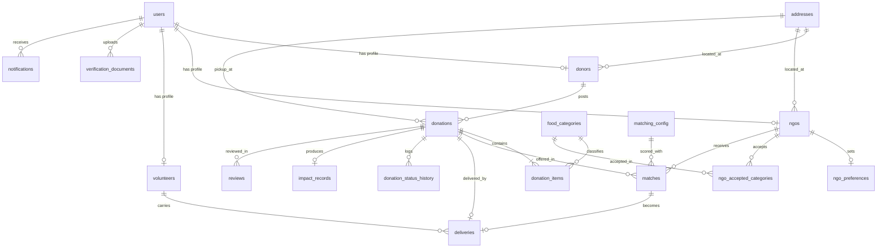

# FoodBridge Database (PostgreSQL)

AI-powered food waste management and donation platform. 18 tables, matching engine in SQL, sample data for Bengaluru.

## Files

| File | What it does |
|---|---|
| `01_create_database.sql` | Creates the `foodbridge` database (run in `postgres` db) |
| `02_schema.sql` | All tables, keys, indexes, triggers |
| `03_functions_and_views.sql` | Matching engine, volunteer assignment, impact trigger, dashboard views |
| `04_sample_data.sql` | Categories, matching weights, users, donors, NGOs, volunteers, donations |
| `05_test_queries.sql` | Queries to test matching and the full donation lifecycle |
| `00_run_all_in_foodbridge.sql` | Files 02 + 03 + 04 combined into one script |

## How to run

**Option A: one command (psql)**
```bash
psql -U postgres -c "CREATE DATABASE foodbridge;"
psql -U postgres -d foodbridge -f 00_run_all_in_foodbridge.sql
```

**Option B: step by step**
```bash
psql -U postgres -f 01_create_database.sql
psql -U postgres -d foodbridge -f 02_schema.sql
psql -U postgres -d foodbridge -f 03_functions_and_views.sql
psql -U postgres -d foodbridge -f 04_sample_data.sql
```

**pgAdmin:** create database `foodbridge`, open Query Tool on it, paste `00_run_all_in_foodbridge.sql`, press F5.

Then open `05_test_queries.sql` and run the queries one at a time.

To start over: `DROP DATABASE foodbridge;` and repeat.

## Tables

| Group | Tables |
|---|---|
| People | `users`, `addresses`, `donors`, `ngos`, `volunteers`, `verification_documents` |
| Food | `food_categories`, `donations`, `donation_items` |
| AI matching | `ngo_preferences`, `ngo_accepted_categories`, `matching_config`, `matches` |
| Delivery | `deliveries`, `donation_status_history` |
| Feedback and impact | `reviews`, `impact_records` |
| System | `notifications` |

## Relationships



## How the AI matching works

`SELECT generate_matches(donation_id);` does this:

1. **Filter** out NGOs that cannot take the food: not verified, too far (their own `max_distance_km`), veg-only but food has non-veg or egg, no cold storage but food is chilled, category not accepted, no daily capacity left, food would spoil before arrival.
2. **Score** each remaining NGO from 0 to 100 on four signals:
   - **Quantity**: how much of the meal count the NGO can take with its remaining daily capacity
   - **Freshness**: safe time left after travel time (distance / speed + buffer)
   - **Urgency**: urgency level, boosted for nearby NGOs
   - **Distance**: closeness compared with the NGO's maximum distance
3. **Combine** using weights in `matching_config` (default 25% quantity, 25% freshness, 20% urgency, 30% distance). Change weights without touching code.
4. **Save** the top N in `matches` with rank and all sub-scores, and notify those NGOs.

After that: `accept_match()` -> `assign_nearest_volunteer()` -> update `deliveries.status` -> impact record is created automatically.

## Notes

- Sample donation times use `NOW()`, so the demo works whenever you run it.
- CO2 saved uses an assumed 2.5 kg CO2e per kg of food. Replace with a cited number before showing it in a pitch.
- Passwords in the sample data are fake. Use bcrypt or argon2 in your backend.
- Distance uses the Haversine formula (straight line). For real road distance, call a routing API (Google Maps, OSRM) from the backend and store it in `deliveries.route_distance_km`.
- For larger scale, enable the PostGIS extension and add a `geography` column plus GIST index to `addresses`.
- Future features fit without breaking tables: payments, chat, recurring donations, multi-city, pickup slots.
